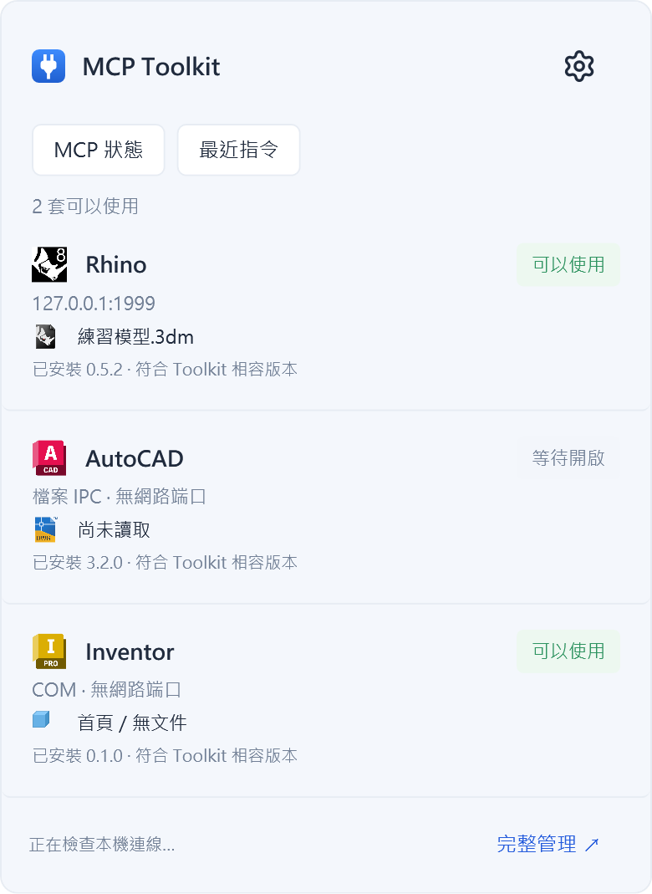
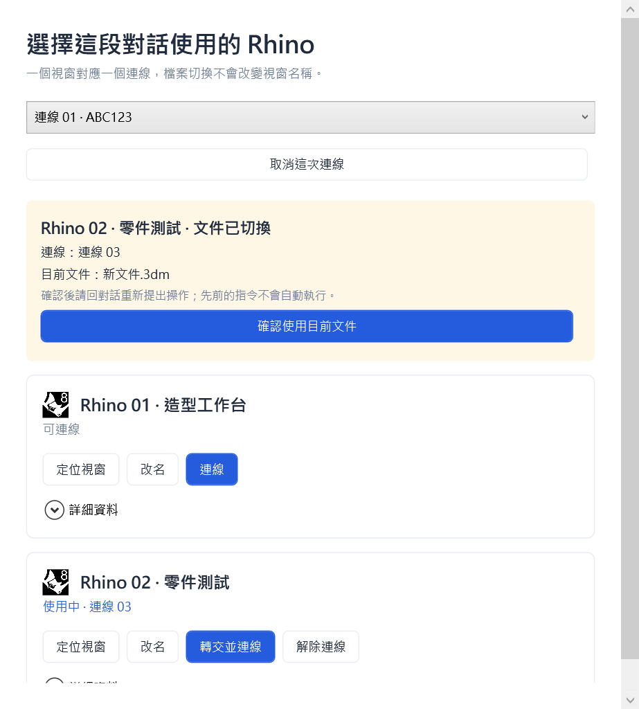

# MCP Toolkit — Beta 測試版

Windows 右下角的 MCP 管理程式，整合 **Rhino、AutoCAD、Inventor**。

點系統匣圖示查看小型狀態面板，需要時再開完整管理視窗。顯示目前文件、連線方式／端口、MCP 版本、安裝狀態與最近指令。

目前修正版為 **0.5.0-beta.5（未簽章 Beta）**，新增 Windows AutoCAD LT 2027 偵測、啟動及連線適配。LT 專項隔離測試與完整 AutoCAD 實機回歸已完成；LT 2027 實機仍待原問題電腦驗收。後續版本預設仍受程式簽章發布門檻限制。

開發中的 **0.5.0-beta.6** 調整 MCP 管理分類、狀態清單及 Markdown 說明，主程式更新集中於「設定與更新」；目前供本機／CI 測試，尚未公開發布。

**Windows 相容性：本 Beta 尚未簽章，開啟 Smart App Control 的電腦可能無法安裝或載入部分元件。正式簽章與 SAC 實機驗收尚未完成。** [簽章盤點與後續處理](docs/windows-signing.md)

**[下載已發布 Windows 預覽版](https://github.com/allen2123231/cad-toolkit/releases/tag/v0.5.0-beta.5)** · **[第一次使用](docs/getting-started.md)** · **[驗證範圍](docs/validation.md)**

## 安裝

1. 下載並開啟 `McpToolkitSetup.exe`。
2. 選擇安裝位置（預設 `AppData/Local/McpToolkit`，可輸入或瀏覽變更），勾選要使用的 MCP，按「安裝所選 MCP」。環境、外掛與 Codex 工具設定一起完成。
3. 開啟軟體；若安裝時 Rhino／AutoCAD 已開啟，先自行儲存並重新開啟一次。
4. Toolkit 在連線檢查通過後自動啟用元件。到 Codex 開啟新對話，以自然語言提出需求。

日常不需要輸入 `mcpstart`、`APPLOAD`，也不用拖曳 `.rhp`。首次仍需自己的 CAD 授權及 Codex 登入。

Windows x64，約 3 GB 空間。不需要自行安裝 Python、Git 或 .NET SDK；程式會使用 Codex 桌面應用程式內附的工具設定功能。

## 日常使用

- **小型面板**：三套 MCP 的狀態、文件、端口與相容版本。
- **完整管理**：各套獨立安裝／修復、Rhino 每段對話獨立選窗、三套軟體視窗命名與定位、最近指令、Windows 登入時啟動、還原／解除設定。
- **視窗綁定**：Rhino 首次操作時彈出 Toolkit 選窗面板，一窗一連線；視窗名稱可改名並同步到標題列，檔名只作附加資訊。文件切換需確認，舊指令不自動重播。AutoCAD、Inventor 此階段先提供視窗命名與定位，多視窗對話路由尚未開放。
- **背景監控**：每輪檢查有時間界限；未開啟、無文件、忙碌或未回應會分別顯示，不把歷史成功當作目前連線。
- **自動開啟**：AI 使用 Toolkit 的啟動工具顯示 CAD 主視窗；已有背景視窗時先顯示，啟動中不重複開啟。Rhino 選窗要求會自動開啟軟體，再讓使用者選擇。
- **自動連線**：Rhino 8 隨外掛啟動；AutoCAD 以每份圖面自動載入套件連線；Inventor MCP 自動附加正常開啟的 Inventor，避免 COM 冷啟動。
- **更新與通知**：每天檢查、同版本只通知一次，按一下更新並保留原位置、MCP 啟用狀態及視窗名稱。0.4.1 及更早版本需先手動安裝本 Beta 一次。
- **完整解除安裝**：移除 Toolkit 管理的 MCP 與外掛，備份設定並保留 CAD 本體、工作文件與其他 MCP。
- **本機紀錄**：只保存工具名稱、視窗與連線名稱、時間、成功／失敗與耗時；保留 7 天、最多 2,000 筆，不記錄參數、提示詞或完整輸出。

AutoCAD 使用檔案 IPC、Inventor 使用 COM，兩者不虛構網路端口。版本顯示採 Toolkit 的固定相容組合，不代表各上游的即時最新版。既有獨立 MCP 可以唯讀檢查；完成 Toolkit 安裝及啟用的新對話才會有完整指令紀錄。

## 預覽版範圍

目前 **0.5.0-beta.2 測試修正版** 採全新安裝與常駐管理介面，不再使用舊八步精靈。包含 AutoCAD MCP 3.2.0、RhinoMCP 0.5.3、Inventor MCP 0.1.0。

MCP Toolkit 本身尚未簽章，完整乾淨 Windows 與真人新手驗收尚待完成。軟體登入、授權或公司外掛政策仍需使用者／管理員處理。程式不強制結束 CAD，也不降低 AutoCAD 安全設定。

離線安裝可把同版本 `cad-toolkit-payload.zip` 放在 EXE 旁。CAD 授權及帳號登入仍可能需要網路。

[開發文件](docs/development.md) · [本版更新](docs/release-0.5.0-beta.5.md)

三套 MCP 分開維護：[Rhino](https://github.com/allen2123231/rhinomcp) · [AutoCAD](https://github.com/allen2123231/autocad-mcp) · [Inventor](https://github.com/allen2123231/inventor-mcp)。圖示及產品名稱屬各原權利人，必要授權文件隨套件保留。
