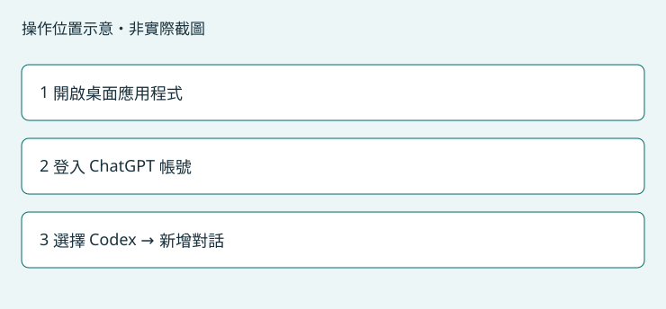

# 準備你的 AI 助手

用桌面應用程式內的 Codex 與本機 CAD 工具對話。帳號登入需要網路。

## 操作位置

Windows 開始功能表 → Codex 桌面應用程式

Codex 桌面應用程式的入口名稱依版本而異；以最後實際呼叫 CAD 工具的唯讀回覆確認完成。

## 只有第一次需要執行

1. 按「官方下載與入門」進入官方頁面，選擇 Windows 桌面版本並完成安裝。Toolkit 不會替你購買帳號或 CAD 授權。
2. 從 Windows 開始功能表開啟 Codex 桌面應用程式，使用自己的帳號完成登入。
3. 在 Codex 建立本機對話，選擇自己的練習資料夾。一般網頁聊天不會直接使用本機 CAD stdio 工具。
4. 在左側使用新增對話／新增任務入口，建立本機對話。若要求資料夾，可選自己的練習資料夾。完成工具啟用後需要再新增一個對話，才能讀取新工具。
5. 完成 Codex 安裝及登入後，回 MCP Toolkit 按「安裝所選 MCP」。Toolkit 會使用 Codex 桌面應用程式內附的工具設定功能，不需要另外在終端機安裝 CLI。

## 完成後會看到

Toolkit 顯示已找到 Codex；桌面應用程式可以建立對話並送出文字。

## 常見問題

- 找不到 Codex：先安裝並登入官方桌面應用程式，再回 Toolkit 按安裝重試。
- 只有一般聊天：依官方入門頁確認 Codex 入口及帳號可用功能；不同版本的介面名稱可能不同。
- 已安裝 Plugin 但對話看不到工具：完成此處的連線及啟用，再新增本機對話。

[官方下載與入門](https://learn.chatgpt.com/docs/quickstart)

[回第一次使用](getting-started.md)
