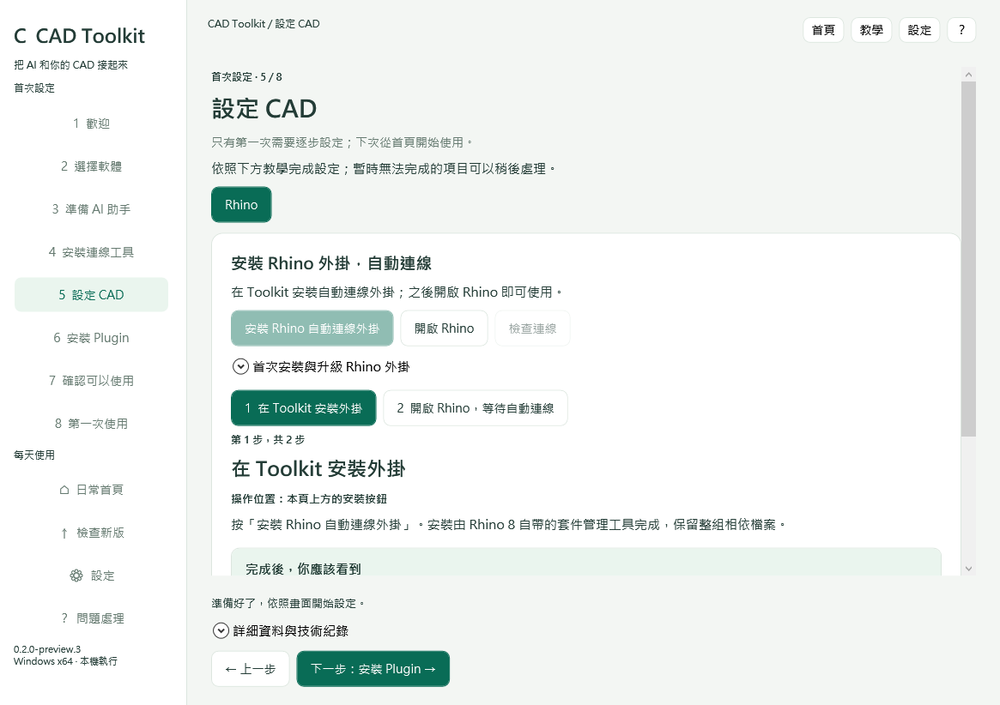

# 安裝 Rhino 外掛，自動連線

在 Toolkit 安裝自動連線外掛；之後開啟 Rhino 即可使用。

## 操作位置

Toolkit 本頁的「安裝 Rhino 自動連線外掛」按鈕。

固定採用本分支 RhinoMCP 0.5.2，已驗證正常啟動、自動橋接與新文件圓柱建模。Toolkit 完整乾淨 Windows 流程仍待驗收。

## 只有第一次或更新外掛時

1. 只在首次安裝或更新外掛時按一次本頁的安裝按鈕。
2. 若 Rhino 正在執行，安裝完成後自行儲存並重開即可載入新版。
3. 套件由固定 GitHub Release 取得並驗證 SHA-256，與 Python 服務版本配對。

## 依序操作

### 1. 在 Toolkit 安裝外掛

操作位置：本頁上方的安裝按鈕

按「安裝 Rhino 自動連線外掛」。安裝由 Rhino 8 自帶的套件管理工具完成，保留整組相依檔案。

完成後：顯示外掛已安裝，並提示直接開啟或重新開啟 Rhino。

### 2. 開啟 Rhino，等待自動連線

操作位置：本頁上方的「開啟 Rhino」與「檢查連線」按鈕

開啟 Rhino 8；若剛才已開啟，先自行儲存並重開。文件準備好後橋接會自動啟動，回 Toolkit 按「檢查連線」。

完成後：Toolkit 讀到目前文件，且外掛與服務版本一致。

## 完成後會看到

檢查顯示橋接已連線與文件摘要，而且外掛與伺服器版本相符。

## 常見問題

- 外掛尚未安裝：先按本頁安裝按鈕，再開啟 Rhino。
- 找不到套件管理工具：先安裝 Rhino 8；若不是預設位置，回「選擇軟體」指定 Rhino.exe。
- 版本不符：確認安裝完成，自行儲存並重開所有使用舊外掛的 Rhino，再重新檢查。
- 仍未連線：等待文件準備好，確認不是安全模式且外掛未停用；再檢查。
- 多個 Rhino 程序：先確認唯一目標；Toolkit 不會猜測或自動關閉其他工作。

## 自選練習：Rhino：一個方塊

在 Rhino 新增空白模型，選擇毫米範本。先保存或保留原工作文件，避免覆寫。

貼到 Codex：

> 先確認目前是我新建的空白 Rhino 練習文件，單位為毫米；如果不是請停止。在原點建立 20 × 20 × 20 mm 的封閉實體方塊，確認尺寸、有效性與封閉狀態。不要修改其他文件，也不要自動儲存。

預期結果：一個 20 mm 方塊，AI 回報幾何有效且為封閉實體。

確認結果後，以 Rhino「另存新檔」存成 CAD練習_方塊.3dm。

[回第一次使用](getting-started.md)
